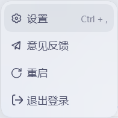

# dsh-quick-restart

给 DeepSeek Harness 桌面版的账号菜单加一个「重启」：二次确认后自动关闭并重新打开应用，失败时告诉你卡在哪一步。



- 包名：`@grapt/dsh-quick-restart`
- 版本：`1.0.4`
- 许可证：MIT
- 作者：Grapt
- 反馈：graptk87@gmail.com

## 它解决什么问题

改完插件、配置或环境变量后，DSH 经常需要完整重启才生效。过去得先关窗口、确认进程退干净、再重新打开，步骤琐碎，也容易漏掉。

这个插件把这件事收进右下角头像菜单：点「重启」、确认一次，应用就会自动退出并重新启动。重启期间按钮会禁用并显示「正在重启…」；成功后提示用时，失败时给出阶段、原因和日志路径。

它不替换原账号菜单，设置、意见反馈、退出登录都保持原样，也不改 DSH 安装目录。

## 功能

- **并列入口**：在「意见反馈」之后、「退出登录」之前新增「重启」，复用宿主菜单项的样式与键盘行为。
- **二次确认**：默认焦点在「取消」，确认框会提示正在生成的内容与终端任务可能中断。
- **过程状态**：重启期间菜单项禁用，文案变为「正在重启…」，图标旋转。
- **结果反馈**：成功显示用时；失败区分无权限（401/403）、Web 模式不支持、helper 缺失、等待超时、拉起失败等原因，并显示日志路径。
- **安全边界**：只接受本机同源请求；POST 必须是 JSON 且带 `confirm:true`；不暴露文件系统或任意命令。
- **不破坏原菜单**：只在同时出现「设置 + 意见反馈」的账号菜单里插入；异常时最坏是不显示重启项，不影响原有功能。


## 适用场景

- 安装、升级、停用插件后，需要完整重启 DSH。
- 修改 profile 配置、环境变量或 Host 侧代码后，需要重新加载。
- 调试桌面版时频繁重启，不想每次找进程或托盘菜单。
- 多窗口同时开着，希望一次全部关闭并重开。

## 安装

1. 在 DSH 插件市场安装 `@grapt/dsh-quick-restart`。
2. 安装后**完整退出并重新打开** DSH 桌面版一次，让 Host 半注册路由。
3. 打开右下角头像菜单，点「意见反馈」下方的「重启」。

首次使用前请先保存正在编辑的内容。

## 使用

1. 点头像 → 「重启」。
2. 在确认框里点「立即重启」。
3. 应用会在几秒内关闭并自动重开；重开后显示结果提示。

取消或按 Esc 不会影响原菜单和当前工作。

## 失败与无权限

- **401 / 403**：请求没有通过来源或登录校验，页面会提示「没有权限执行重启」。
- **Web 模式**：`dsh web` 没有桌面进程可重启，会明确提示不支持。
- **helper 缺失或无法启动**：会显示对应阶段，重启不会发生。
- **等待超时或拉起失败**：弹窗会给出阶段、原因和日志路径。

日志与结果文件：

```text
%USERPROFILE%\.dsh\dsh-quick-restart\
├─ restart.log        # 每次尝试的阶段日志
└─ last-result.json   # running / relaunched / failed
```

## 支持范围

- DSH 桌面版 **0.2.1-rc.2**，Windows 10/11 x64：已实际完成端到端重启（应用自动关闭并以新进程重开）。
- macOS / Linux：同一套 helper 逻辑，但尚未实测，不承诺可用。
- `dsh web`：不支持。

## 实现方式与边界

账号菜单由 DSH 桌面版内置包绘制，注册在 `settings.launcher` 这个 single 槽，菜单项写死在组件里，没有 item 级插槽。替换整个菜单会破坏账号、退登、意见反馈等原有能力，所以本插件采用**受控 DOM 增强**：只在账号菜单打开时，克隆「设置」行的样式，插入一个独立的「重启」行。

这意味着：

- 样式和键盘行为能与原生项保持一致；
- 但依赖宿主菜单的 `[role="menu"]`、`button[role="menuitem"]` 和「设置 + 意见反馈」文案结构，DSH 大改版后入口可能暂时不显示；
- 任何增强异常都会被捕获，最坏结果只是「重启项不出现」，不会破坏原菜单。

重启本身是**强制结束主进程再拉起**，不会走 Electron 的正常退出清理。正在生成的回答、运行中的终端任务、未保存的编辑器内容会中断。

## 版本记录

- **1.0.4**：把「重启」移到「意见反馈」之后、「退出登录」之前。
- **1.0.3**：修复点击头像时头像/名称块被菜单首帧短暂遮挡。
- **1.0.2**：修复菜单打开后「重启」延迟一帧出现。
- **1.0.1**：修复菜单显示 `menu.restart` 原始 key。
- **1.0.0**：首个版本。

## 许可证

MIT，见 [LICENSE](LICENSE)。

本项目是社区插件，非 DeepSeek 官方产品。
